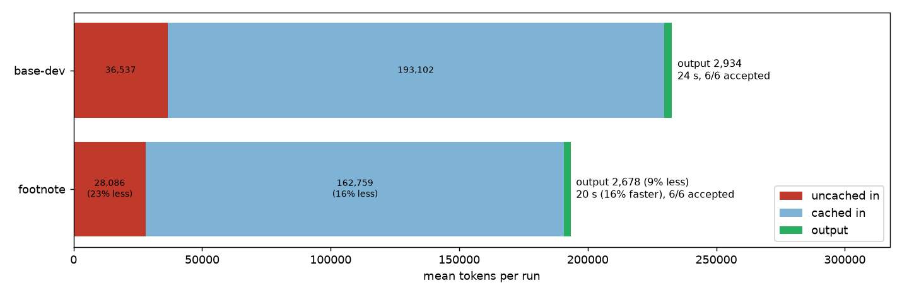

# Typical dev stack vs Footnote stack (#242), 2026-11-22

Small pilot: 6 runs per arm. It shows the fixed cost of a loaded stack, not a general saving.

## Setup
- Model `claude-sonnet-5-5`, reasoning effort medium, `claude -p`. Runner: `../lean_b_run.py` with arms `base-dev,footnote`; configs built by `setup_arms.py`. Raw lines: `runs.jsonl`.
- Tasks: ladder L1 (interval merge) and L2 (dependency fixture), 3 runs each. Flow is used only for these fixtures and their checkers; it is loaded in neither arm. Its files come from the tree before #349 removed them (`git archive e005faa^ flow skills`).
- Each arm is a full `CLAUDE_CONFIG_DIR` copy of the user config (credentials, CLAUDE.md, plugins) with its own settings, hooks and MCP list. The live config is not touched.
- Both arms get the same T3 Code system-prompt text and T3 tool names (`t3-append.md`, via `--append-system-prompt-file`), because headless `claude -p` cannot load T3's in-process MCP. Both also get the cloudflare plugin, the plugins the account syncs to every session, and the same user CLAUDE.md. claude.ai connectors are off in both (`ENABLE_CLAUDEAI_MCP_SERVERS=false`).
- **base-dev**: 115 skills (42 user skills plus 72 GSD skills and the codebase-memory skill), 43 agents, GSD, impeccable and codebase-memory hooks, and the codebase-memory-mcp, memory, context7, playwright and likec4 MCP servers. Init: 110 tools and 170 skills.
- **footnote**: footnote-memory MCP (memory, code graph, library) and its hooks (memory and lean), `memory.skills` on with the 42 user skills indexed as one theme (40 indexed, 2 skipped), and no listed user skills. The Footnote state is a copy of the live one, so recall sees real memories. Init: 43 tools and 57 skills.
- Accepted = the level's own checker passes and the arm's own MCP server was connected at init. Every run met both.

## Per arm, mean per run, each value against base-dev

| arm | runs | uncached in (incl. cache write) | cached in | output | time | accepted |
|---|---|---|---|---|---|---|
| base-dev | 6 | 36,537 (baseline) | 193,102 (baseline) | 2,934 (baseline) | 24 s (baseline) | 6/6 (baseline) |
| footnote | 6 | 28,086 (23% less) | 162,759 (16% less) | 2,678 (9% less) | 20 s (16% faster) | 6/6 (baseline) |

| arm | cost per accepted delivery | fixed overhead | read tokens | turns |
|---|---|---|---|---|
| base-dev | $0.195 (baseline) | 47,245 (baseline) | 762 (baseline) | 5 (baseline) |
| footnote | $0.155 (20% less) | 38,968 (18% less) | 827 (9% more) | 5 (baseline) |

Cost is the list price that `footnote usage` computes. Fixed overhead is the first call's whole prompt.

## What the numbers support
- Each footnote run was cheaper and faster than the base-dev run of the same task and run number (6 of 6 pairs), and the spread within an arm is small ($0.139 to $0.173 for footnote, $0.174 to $0.214 for base-dev).
- Most of the gap is fixed overhead: about 8,300 tokens more on every call of a base-dev session, from 67 more tools, 113 more listed skills and 43 more agents. On these 5-turn tasks it is re-read every turn, so it costs about 20% per delivery. On longer sessions it stays the same size in tokens per call, so its share of the bill falls as task context grows.
- Quality did not separate the arms: both accepted 6/6. These tasks are too easy to show any gain from memory or skills.
- **Not measured**: turns before the first edit. The agents wrote files through the shell, which `explore_cost.py` does not count as edits, so that column only repeats the total turn count and is left out above. No skill suggestion fired in any footnote run: the tasks are plain Python and no indexed skill reached the 40% topic-word cover. Memory recall did fire on every prompt.
